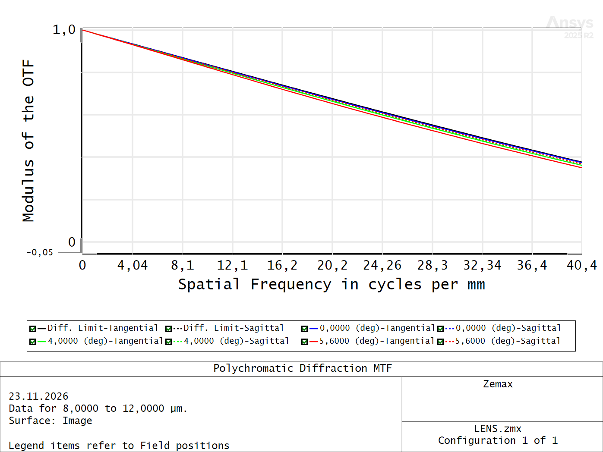
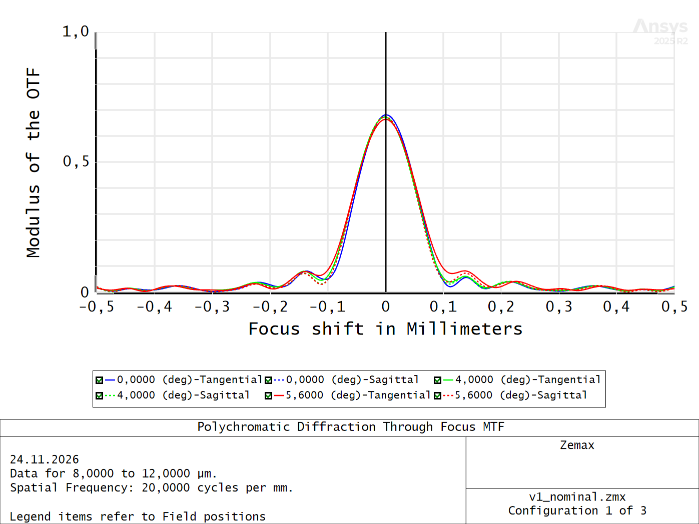
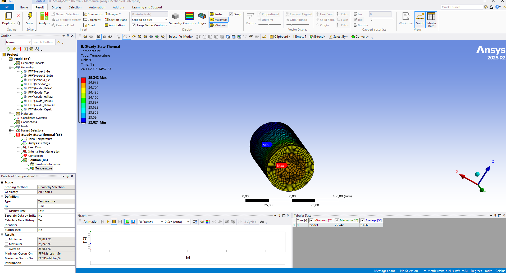
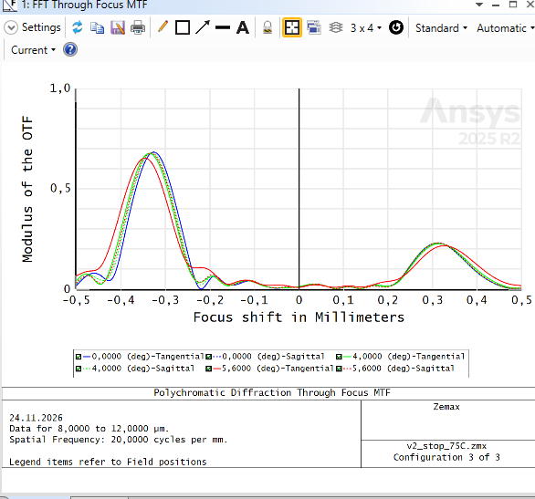
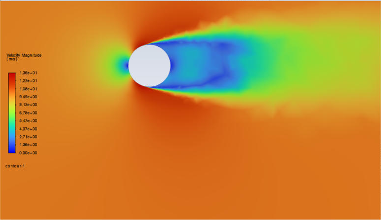
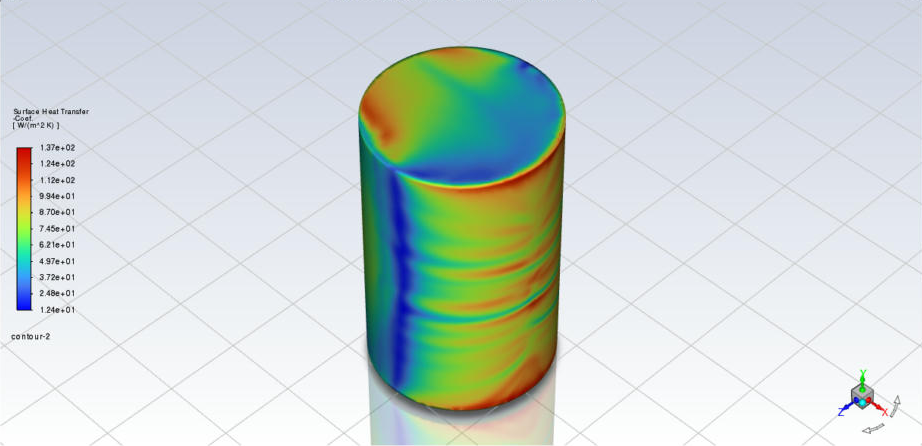
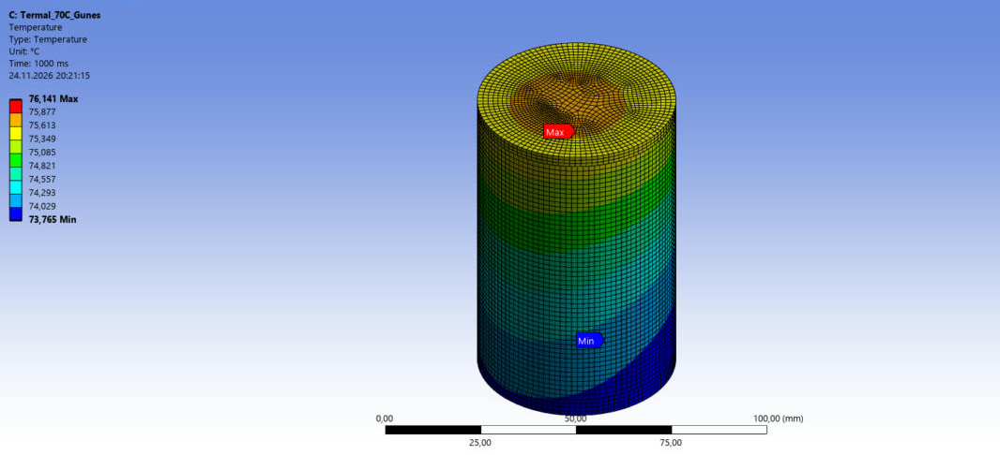
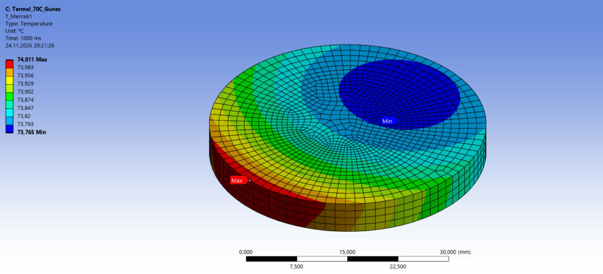
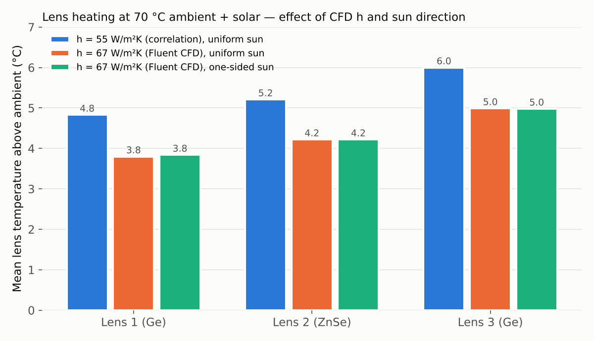

# LWIR Objective — Structural-Thermal-Optical (STOP) Analysis

Design of a 50 mm f/1.25 long-wave infrared (8–12 µm) objective in Zemax OpticStudio, followed by a thermal analysis of the lens and housing in Ansys Mechanical, with the computed lens temperatures fed back into the optical model.

**Main result:**
- Under a 70 °C ambient with solar load, the lenses run 4–6 °C above ambient. That adds **26–35 µm of defocus** on top of what the ambient temperature alone predicts, close to one full depth of focus (±31 µm).
  - The 35 µm figure uses correlation h; the 26 µm figure uses Fluent CFD h.
  - A focus compensator therefore has to be driven by a sensor at the lens mount, not by ambient temperature.
- External-flow CFD (Fluent, k-ω SST, y+ ≈ 0.5) gives h = 67 W/m²·K, 22–26 % above the correlation.
- One-sided solar loading leaves the mean lens temperatures unchanged and creates gradients of only ≤0.25 °C, which is negligible optically (≤λ/20).

---

## 1. Optical design (Zemax OpticStudio 2025 R2)

| Parameter | Value |
|---|---|
| Effective focal length | 50.0 mm |
| Entrance pupil / f-number | 40 mm / f/1.25 |
| Spectral band | 8–12 µm (primary 10 µm) |
| Field of view | 0°, 4°, 5.6° (half-diagonal) |
| Detector (assumed) | 640 × 512, 12 µm pitch uncooled microbolometer → Nyquist 42 lp/mm |
| Elements | Ge / ZnSe / Ge, all spherical |
| Total track | 71.85 mm (back focal distance 4.91 mm) |

Prescription at 20 °C (`v1_nominal.zmx`, configuration 1):

| Surface | Radius (mm) | Thickness (mm) | Material | Clear semi-diameter (mm) |
|---|---|---|---|---|
| 1 (stop) | 63.783 | 5.000 | Germanium | 20.32 |
| 2 | 90.200 | 21.107 | air | 19.47 |
| 3 | −143.609 | 4.000 | ZnSe | 14.97 |
| 4 | −191.407 | 31.832 | air | 14.83 |
| 5 | 20.785 | 5.000 | Germanium | 8.18 |
| 6 | 20.210 | 4.913 | air | 6.54 |

The design is diffraction-limited at 20 °C: polychromatic MTF at the 42 lp/mm Nyquist frequency is 0.353 against a diffraction limit of 0.355 (99 %). The through-focus MTF at 20 lp/mm peaks at 0.68, at the nominal image plane.

## 2. Thermal defocus with uniform temperature

Using Zemax *Make Thermal*: −40 / 20 / +70 °C, glass dn/dT and CTE from the INFRARED catalog, and aluminium air-space mounts (CTE 23.6 × 10⁻⁶ /K).

| Temperature | Best-focus shift | Peak MTF @ 20 lp/mm (refocused) |
|---|---|---|
| −40 °C | +0.36 mm | 0.689 |
| 20 °C | 0.00 mm | 0.68 |
| +70 °C | −0.29 mm | 0.675 |

- The focus shift is linear at **−5.9 µm/°C**, dominated by the dn/dT of germanium (≈400 × 10⁻⁶ /K).
- Refocused, image quality is unchanged at every temperature. **The problem is focus position, not aberrations.**
- With the detector fixed, MTF collapses to ≈0 at both temperature extremes.

| −40 °C | 20 °C | +70 °C |
|---|---|---|
|  |  |  |

### Athermalization options investigated

| Approach | Outcome |
|---|---|
| Titanium instead of aluminium housing | Shift at +70 °C reduced only from −0.30 to −0.27 mm (≈10 %). A single housing material would need CTE ≈ −85 × 10⁻⁶ /K, which no metal has. |
| Passive optical (Ge / ZnSe / AMTIR-1, all-spherical, optimised over 3 temperatures) | Focus shift removed, but peak MTF @ 20 lp/mm fell from 0.68 to ≈0.24–0.35 at f/1.25 |
| **Active focus compensator (selected)** | Restores diffraction-limited performance; required travel ≈ 0.69 mm (−0.33 … +0.36 mm) |

## 3. Thermal model (Ansys Workbench / Mechanical 2025 R2, steady-state)

**Geometry:** `lwir_geometri_spaceclaim.py`, a parametric SpaceClaim script. Lenses are modelled as flat disks of their centre thickness and clear diameter. Each lens sits in an aluminium mount ring inside a Ø46/52 mm tube with a 3 mm rear cap. The detector is a Ø12 × 1 mm silicon disk. Nine bonded contacts are detected automatically.

**Materials:**

| Material | k (W/m·K) | ρ (kg/m³) | E (GPa) | ν | CTE (10⁻⁶ /K) |
|---|---|---|---|---|---|
| Germanium | 60 | 5323 | 103 | 0.28 | 5.7 |
| ZnSe | 18 | 5270 | 67 | 0.28 | 7.1 |
| Silicon | 149 | 2330 | 130 | 0.28 | 2.6 |
| Aluminium alloy | Ansys library | | | | |

**Loads and boundary conditions:**

- Detector: 0.5 W internal heat generation.
- Electronics: 3 W heat flow into the rear cap.
- External convection on all six exterior faces: h ≈ 55 W/m²·K (Churchill–Bernstein gives 53; rounded up) for 10 m/s cross-flow over a Ø52 mm cylinder.
- Solar (case B only): 1000 W/m², absorptivity 0.5, averaged around the circumference → 160 W/m² on the tube.

**Results:**

| Case | Lens 1 (Ge) | Lens 2 (ZnSe) | Lens 3 (Ge) | Model min / max |
|---|---|---|---|---|
| A: 20 °C, no sun | — | — | — | 22.8 / 25.2 °C (avg 23.7) |
| **B: 70 °C + sun** | **74.8 °C** | **75.2 °C** | **76.0 °C** | 74.8 / 77.2 °C |

- **Energy-balance check (case A):** 3.5 W / (55 W/m²·K × 0.0178 m²) = 3.6 K above ambient → 23.6 °C, against a computed average of 23.7 °C.
- **Gradient inside each lens is below 0.1 °C.** Thermal behaviour is governed by the bulk temperature offset, not by gradients.
- **Mesh independence** (lens 3 mean temperature, case B): 3 mm, 5,295 elements → 75.998 °C; 1.5 mm → 75.997 °C; 0.75 mm, 226,595 elements → 75.998 °C. The variation is below 0.002 %, and the 1.5 mm mesh was retained.

| Case A: 20 °C | Case B: 70 °C + solar |
|---|---|
|  |  |

## 4. Closing the STOP loop

The mean Ansys lens temperature for case B (≈75.5 °C) was applied as the configuration temperature in Zemax (`v2_stop_75C.zmx`):

| | Best-focus shift |
|---|---|
| Ambient-based assumption (70 °C) | −0.290 mm |
| Thermal-model lens temperature (75.5 °C) | **−0.325 mm** |
| Difference | **35 µm ≈ 1 × depth of focus** |

A compensator positioned from ambient temperature would leave the image ~35 µm out of focus. Read from the through-focus curve, that lowers MTF at 20 lp/mm from ≈0.68 to ≈0.55, and the loss is larger at Nyquist. The temperature sensor for the compensator belongs at the lens mount.

## 5. Project 1b — CFD convection and one-sided solar loading

Two simplifications from Section 3 were removed: the correlation-based external h, and the circumferentially smeared solar load.

### 5.1 External flow (Ansys Fluent 2025 R2)

- **Domain:** SpaceClaim enclosure around the pod, with the pod body suppressed for physics. Boundaries are a velocity inlet at 10 m/s, a pressure outlet, symmetry side walls, and an isothermal pod wall.
- **Mesh:** an inflation layer on the pod wall (first cell 0.03 mm, 15 layers). The resulting **y+ is 0.55**, so the viscous sublayer is resolved and no wall functions are needed.
- **Model:** steady RANS with k-ω SST and the energy equation. Reference temperature for h is set to the free-stream value.
- **Result:** area-weighted surface heat-transfer coefficient on the pod **h = 66.96 W/m²·K**.
  - This is 26 % above the Churchill–Bernstein value (53) and 22 % above the 55 used in Section 3.
  - The difference is expected: the correlation is for an infinite cylinder, while the pod has end faces and a finite length, which thin the boundary layer.

The local h on the pod ranges from ≈12 W/m²·K along the separation lines to ≈137 W/m²·K at the front stagnation line and the end-face edges. Behind the pod, the wake shows a velocity deficit at mid-length.

| Velocity magnitude, mid-length cross-section (flow left → right) | Surface heat-transfer coefficient on the pod |
|---|---|
|  |  |

**Coupling to Mechanical:** the full surface h distribution was mapped onto the thermal model, both through the Workbench link and directly from the Fluent `.cas/.dat.h5` files. Mapping reached 100 %, but Mechanical crashed at solve every time (likely memory on the available workstation). The area-averaged CFD h was therefore applied as a uniform film coefficient. This is a documented limitation (see below).

### 5.2 One-sided solar loading

Section 3 smeared the solar input around the circumference: 1000 W/m² × α = 0.5 gives 500 W/m² on the projected area, which averages to 160 W/m² over the tube surface.

Here the sun is placed overhead (+Z). The absorbed flux follows the local incidence angle:

q(θ) = 500 · cos θ W/m² on the sunlit half, and 0 on the shaded half.

In Mechanical this is a spatially tabular heat flux in global Z: 0 at z ≤ 0, rising linearly to 5 × 10⁻⁷ kW/mm² at z = +26 mm. Because z = R·cos θ on the tube surface, this reproduces the cosine distribution exactly, without splitting the geometry. The total absorbed power (≈1.95 W) is the same as in the smeared case.

### 5.3 Results (70 °C ambient + solar)

| Case | Lens 1 (Ge) | Lens 2 (ZnSe) | Lens 3 (Ge) | Model min / max |
|---|---|---|---|---|
| h = 55 (correlation), uniform sun — Section 3 | 74.83 | 75.21 | 76.00 | 74.8 / 77.2 °C |
| h = 66.96 (CFD), uniform sun | 73.80 | 74.22 | 74.99 | — |
| **h = 66.96 (CFD), one-sided sun** | **73.84** | **74.22** | **74.98** | 73.77 / 76.14 °C |

Lens values are mean temperatures in °C.

Intra-lens temperature spread in the one-sided case (max − min):

| Lens | ΔT | dn/dT (10⁻⁶ /K) | Thickness | Optical path difference (PV) |
|---|---|---|---|---|
| 1 (Ge) | 0.25 °C | ≈396 | 5 mm | ≈0.50 µm ≈ λ/20 |
| 2 (ZnSe) | 0.24 °C | ≈61 | 4 mm | ≈0.06 µm ≈ λ/170 |
| 3 (Ge) | 0.13 °C | ≈396 | 5 mm | ≈0.26 µm ≈ λ/38 |

The OPD values are an upper bound from ΔT × dn/dT × thickness at λ = 10 µm.

| One-sided sun, full model | Lens 1 gradient |
|---|---|
|  |  |

### 5.4 Findings

1. **CFD lowers lens temperatures by about 1.0 °C** compared with the correlation. The mean lens temperature rise over ambient drops from ≈5.3 °C to ≈4.3 °C.
   - With the −5.9 µm/°C focus slope, the STOP defocus beyond the ambient-based value drops from ≈35 µm to **≈26 µm (≈0.8 × depth of focus)**.
   - This is a linear estimate from the slope; it was not re-run in Zemax.
   - The conclusion of Section 4 still holds: the compensator needs a lens-mount temperature sensor.
2. **Sun direction does not change mean lens temperatures** (all within 0.04 °C). For the same absorbed power, the smeared solar load is a valid simplification for focus prediction.
3. **One-sided sun creates intra-lens gradients of at most 0.25 °C.** The worst-case thermo-optic OPD is ≈λ/20 PV, which is well inside the diffraction limit. Line-of-sight tilt and wavefront error from solar asymmetry are negligible for this pod.

## Assumptions and limitations

- The optical temperature in each Zemax configuration is uniform; the three lens temperatures (74.8–76.0 °C) are represented by their mean.
- The thermal model is conduction-only: internal air convection and radiation are not modelled, and lenses are flat disks.
- External h: Sections 3–4 use a correlation. Section 5 uses the Fluent area-averaged h as a uniform film coefficient, because mapping the full CFD surface distribution crashed Mechanical on the available hardware.
- Solar absorptivity and the overhead sun direction are assumptions. Sky and ground radiation exchange is not modelled.
- No thermo-elastic (structural) analysis was run. The sub-0.1 °C intra-lens gradients suggest surface deformation is negligible here, but this is not verified.
- The detector format and solar absorptivity are assumed values.

## Next steps

1. ~~External-flow CFD~~ and ~~one-sided solar loading~~: done in Section 5.
2. Map the full CFD h distribution (on a workstation with more memory) to check the uniform-h assumption.
3. Thermo-structural analysis in Static Structural, with Zernike decomposition of the surface deformation fed back to Zemax.
4. Transient warm-up to size the compensator control loop.

## Repository contents

| File | Content |
|---|---|
| `v1_nominal.zmx` | Zemax design with −40 / 20 / +70 °C thermal configurations |
| `v2_stop_75C.zmx` | Zemax STOP case (75.5 °C lens temperature from Ansys) |
| `stop_termal.wbpz` | Ansys Workbench archive incl. Fluent external-flow system (results excluded; press Solve to regenerate) |
| `lwir_geometri_spaceclaim.py` | SpaceClaim script that builds the thermal geometry |
| `STOP_report.pdf` / `STOP_report.md` | Technical report |
| `*.png` | Figures 00–12 used in this README |
| `*.csv`, `plot_focus_shift.py`, `plot_project1b.py` | Result tables (incl. `cfd_external_flow.csv`) and plotting scripts |

**Tools:** Ansys Zemax OpticStudio 2025 R2 · Ansys Workbench / SpaceClaim / Mechanical / Fluent 2025 R2 · Python (matplotlib)

**Author:** Tufan Turşu · [github.com/SirPicklee](https://github.com/SirPicklee)
